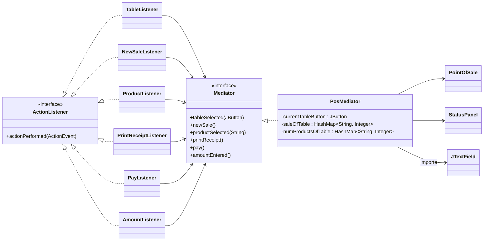

# Point of Sale con el patrón Mediator (Java Swing)

Interfaz gráfica de un TPV (terminal de punto de venta) para un bar: mesas, productos, ventas, ticket y pago. La práctica consistía en **rediseñar la interfaz con el patrón Mediator** para quitar las dependencias cruzadas entre los listeners de Swing.

Práctica en grupo de **Disseny de Software** (Grado en Ingeniería Informática, UAB, curso 2026-27).

## El problema

En la versión inicial, cada `ActionListener` conocía a muchos otros objetos: el modelo (`PointOfSale`), el panel de estado, el listener de la mesa actual, el del importe... Al pulsar una mesa, su listener tenía que avisar a todos los demás. Era una red de dependencias muchos-a-muchos, difícil de mantener.

## La solución

- **`Mediator`** (interfaz) y **`PosMediator`** (mediador concreto): es la única clase de la interfaz que conoce el modelo `PointOfSale`, el `StatusPanel` y el campo del importe. También guarda el estado que antes estaba repartido: la mesa seleccionada, la venta abierta de cada mesa y cuántos productos lleva.
- **Listeners** (`TableListener`, `NewSaleListener`, `ProductListener`, `PrintReceiptListener`, `PayListener`, `AmountListener`): solo conocen al mediador y le dicen qué ha pasado (`tableSelected`, `newSale`, `productSelected`, `printReceipt`, `pay`, `amountEntered`).
- Las dependencias pasan de N×N a N×1, y todas las reglas de la interfaz quedan en un único sitio.



El diagrama completo en PlantUML está en [`docs/mediator.puml`](docs/mediator.puml).

## Casos que controla la interfaz

- Pulsar *New sale*, un producto, *Receipt* o *Pay* sin haber seleccionado mesa.
- Añadir productos a una mesa sin venta abierta.
- Abrir una venta nueva en una mesa que aún tiene una sin pagar.
- Imprimir el ticket o pagar una venta sin productos.
- Importe vacío, cero, no numérico o insuficiente.
- La mesa seleccionada se marca en verde, y las que tienen una venta pendiente se distinguen de las libres.

## Mediator frente a Observer

En [`docs/comparacio_mediator_observer.txt`](docs/comparacio_mediator_observer.txt) (en catalán) se comparan los dos patrones y se explica cómo se combinan en este programa: los `ActionListener` de Swing ya son un Observer, y los usamos para enviar los eventos al mediador.

## Estructura

```
src/
  pos_creditcard/   modelo del TPV (ventas, catálogo, pago en efectivo y con tarjeta), proporcionado por la asignatura
  ui_solution/      interfaz rediseñada con Mediator (nuestro trabajo)
images/             imágenes de los productos
docs/               diagrama de clases y comparación Mediator / Observer
```

## Cómo ejecutarlo

Necesita Java 11 o superior. Desde esta carpeta (el programa lee `src/pos_creditcard/catalog.txt` e `images/` con rutas relativas):

```bash
javac -encoding UTF-8 -d out $(find src -name "*.java")
java -cp out ui_solution.Main
```

En IntelliJ: abrir la carpeta como proyecto, marcar `src` como *Sources Root* y ejecutar `ui_solution.Main` con esta carpeta como *working directory*.
